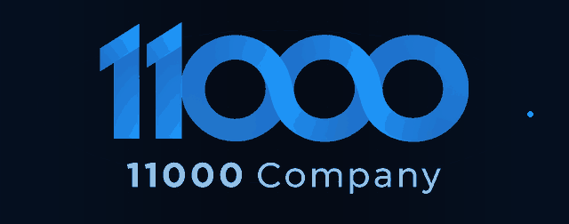

ONZEMIL COMPANY
Catálogo de projetos e experiências digitais
Sites, sistemas e e-commerce que conectam tecnologia a negócios reais.

Não veja apenas. Experimente.

Projetos · Tecnologias · Executar localmente · Orçamento

Sobre o catálogo
Portfólio interativo da ONZEMIL Company, desenvolvido para apresentar projetos reais, funcionalidades verificadas e experiências digitais. Cada projeto tem uma página individual e um caminho direto para solicitar uma solução semelhante pelo WhatsApp.

Identidade visual com fundo grafite, azul oficial #1e93f5 e GIFs da marca existentes em public/images/brand/.
Projetos
Projeto	Segmento	Estado	Experiência
Aurora Hospedagens	Hospedagens e turismo	Publicado	Prévia, capturas e site original
Euclides Fitness	Assistência técnica fitness	Publicado	Site externo, sem iframe
Havoc	Loja virtual de moda	Em desenvolvimento	Apresentação
Elysium Concept	Perfumes e joias	Em desenvolvimento	Apresentação
BASE311	Plataforma digital	Em desenvolvimento	Apresentação
Base Phone	Comércio de iPhones	Em desenvolvimento	Apresentação

Os projetos em desenvolvimento não são apresentados como produtos concluídos. Suas páginas não exibem demonstrações fictícias ou capturas inventadas.

Tecnologias
Next.js 16 · React 19 · TypeScript · Tailwind CSS 4 · Vitest · Playwright
- Interface: App Router, catálogo responsivo e páginas estáticas por projeto.
- Dados: src/data/projects.ts, sem expor código privado dos projetos.
- Conversão: WhatsApp centralizado em src/lib/whatsapp.ts.
- Entrega: exportação HTML/CSS/JS para hospedagem estática em out/.
Executar localmente
Requer Node.js 20.9+ e npm.
npm ci
npm run dev
Abra http://localhost:3000.
Qualidade e testes
npm run lint
npx next typegen
npx tsc --noEmit
npm test
npm run build
npx playwright install chromium
npx playwright test
Prévia da versão estática
npm run build
npx serve out -p 4173
Configuração para publicação
1. Defina NEXT_PUBLIC_SITE_URL=https://seu-dominio.com.br com o domínio real, sem barra final, antes do build. Consulte .env.example.
2. Execute npm ci && npm run build.
3. Publique o conteúdo de out/ em uma hospedagem estática HTTPS.
4. Teste navegação, SEO, visualizador, WhatsApp e responsividade no domínio definitivo.
Sem um domínio configurado, a versão gerada usa noindex e bloqueia rastreamento no robots.txt. Isso evita indexação prematura da URL provisória. Este repositório não faz deploy automaticamente.
Estrutura
src/
  app/                    # páginas e SEO
  components/             # visualizador, cards, filtros e layout
  data/projects.ts        # projetos cadastrados
  lib/                    # WhatsApp e endereço canônico
public/images/brand/      # GIFs e identidade oficiais
public/images/projects/   # capturas reais dos projetos
legacy/                   # protótipo anterior preservado
tests/                    # unitários e end-to-end
docs/                     # inventário, plano e validação
Documentação
- [Inventário de projetos](docs/INVENTARIO_PROJETOS.md)
- [Validação e pendências](docs/VALIDACAO_CATALOGO.md)
- [Especificação e decisões](docs/superpowers/specs/2026-11-22-catalogo-onzemil-design.md)
- [Plano de implementação](docs/superpowers/plans/2026-11-22-catalogo-onzemil-implementation.md)
- GitHub Actions
Limitações verificadas: sites externos podem bloquear iframes via CSP/X-Frame-Options; o navegador não permite detectar todo bloqueio cross-origin com confiabilidade. O catálogo oferece link externo e, na Aurora, capturas reais como alternativa. Uma captura confiável de Euclides e uma auditoria Lighthouse de produção ainda dependem de validação.

ONZEMIL Company · João Pessoa — PB

Transformamos ideias em soluções digitais.

Instagram @onzemil.company · WhatsApp +55 83 98649-7309

